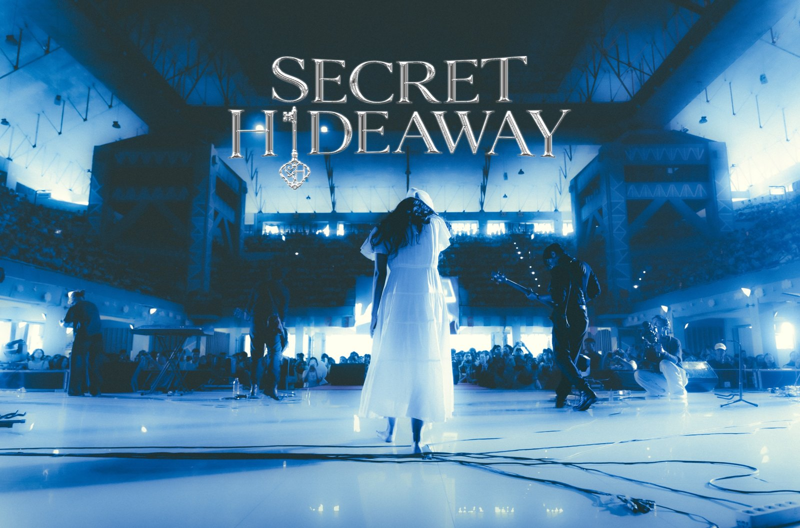

# Hey there, I'm Rafi! 👋

**UI/UX designer · Frontend dev · AutoCAD**
 
*powered by way too much coffee & cigarettes ☕🚬*

 

Spotify runs my mood — if you catch me without headphones, send help 🎧
 
Sleepy is sanity. No cap. :v 😴💯

 

🔭 Currently busy with **Laravel** & **Node JS**

 

  

 

  

